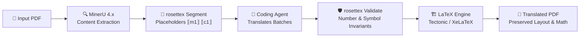

<div align="center">

# rosettex 📜✨

**Agent-native scientific PDF translation with pixel-accurate LaTeX rebuilds.**

[](pyproject.toml)
[](#)
[](#)
[](#-languages-and-fonts)
[](#)
[-critical?style=flat-square)](#)
[](LICENSE)

[Quick Install](#-quick-install-let-your-coding-agent-do-it) • [Key Features](#-key-features) • [How It Works](#-how-it-works) • [Usage](#-how-to-use) • [Languages & Scripts](#-languages-and-fonts) • [Manual Setup](#-manual-install)

---

</div>

`rosettex` is a specialized tool designed for **coding agents in a harness** ([Claude Code](https://claude.ai/code), [Cursor](https://cursor.com), Codex, OpenCode, [Gemini CLI](https://github.com/google-gemini), [Antigravity](https://github.com), Cline, Windsurf, etc.) to translate whole scientific PDF papers into another language. 

**`rosettex` does not translate by itself**—your coding agent is the translator. `rosettex` handles the hard engineering: extracting structured content with MinerU, chunking into batches with semantic placeholders, verifying translations against strict invariants, and rebuilding the PDF with LaTeX so formulas, tables, citations, and cross-references remain real, selectable, and clickable objects.

---

## 🌟 Key Features

| Feature | Description |
|---|---|
| 🤖 **Agent-Centric Pipeline** | Exposes a deterministic `--json` protocol designed specifically for LLM agents to execute, check, and resume. |
| 📐 **Real Formulas & Tables** | Math expressions and tables are typeset as real characters and LaTeX objects—never blurry screenshot crops. |
| 🏛️ **Venue Layout Fidelity** | Recognizes and matches the layout styles of **IEEE**, **Springer (LNCS)**, **Elsevier (CAS)**, and **ACM** papers. |
| 🔗 **Preserved References** | Citations (`\cite{}`), section links, footnotes, and figures retain full hyperlink navigation in the output PDF. |
| 🌐 **15 Scripts, 21 Languages** | Ships with 14 subset Noto fonts (SIL OFL 1.1) covering Latin, CJK, Cyrillic, Arabic (RTL), Devanagari, Thai, and more. Zero font installation required. |
| ⚡ **100% CPU Friendly** | Runs cleanly on standard Linux, macOS (Intel & Apple Silicon), and Windows without requiring dedicated GPUs. |

---

## 🔄 How It Works



1. **Extract:** MinerU extracts semantic blocks, figure crops, and formulas from the PDF text layer.
2. **Segment:** Content is batched (≤ 3000 chars) with protected placeholders (`⟦m1⟧`, `⟦c1⟧`, `⟦r1⟧`) for math, citations, and references.
3. **Translate:** Your agent translates batch by batch with context from document outline and terminology.
4. **Verify:** `rosettex` verifies each batch against strict multiset checks (no missing placeholders, numbers preserved).
5. **Typeset:** Tectonic or XeLaTeX compiles the document with native fonts, venue styles, and multi-pass float placements.

---

## 🚀 Quick Install: Let Your Coding Agent Do It

> [!TIP]
> **Zero configuration needed**: Simply copy the prompt below and send it to your agent.

### Instructions:
1. Open your coding agent (Claude Code, Cursor, Codex, Antigravity, OpenCode, Cline, etc.) in any workspace folder.
2. Copy the prompt inside the box below and paste it as your instruction.
3. Confirm prompts when asked (the agent will ask before installing `uv` or updating shell profiles).
4. *Setup takes ~10–20 minutes and ~3 GB disk (mostly MinerU models). No root/administrator rights needed.*

```text
Install the tool "rosettex" on this computer and connect it to yourself, so that later I can ask you to translate scientific PDF papers. Source: https://github.com/20235106-huynk/rosettex

Rules for the whole task:
- Never use sudo or administrator rights. Install only into: the home folder ~/.rosettex (Windows: %USERPROFILE%\.rosettex), the folder where `uv` puts tools, and the skill/instructions file of your own harness (step 6). Do not touch anything else.
- Ask me before: running a remote installer script (step 1), or editing my shell profile (step 3).
- Run one command at a time. If a command fails, show me the error and try the fix given in the step; do not improvise other fixes, and do not delete anything you did not create.
- Step 4 downloads about 2 GB and can take 10+ minutes: run it with a long timeout or in the background and wait for it to finish. Downloads that stall can simply be stopped and rerun; they resume.
- "<HOME>" below means my home folder. On Windows, executables live in "Scripts\" and end in ".exe" where Linux/macOS use "bin/".

Steps, in order:

0. Find out my operating system and CPU, and which harness you are (Claude Code, Codex, OpenCode, Cursor, Gemini CLI, Antigravity, Cline, Windsurf, or other).

1. uv (the Python tool manager). Run `uv --version`. If it is missing, tell me what you are about to run and wait for my OK, then install it with the official installer: Linux/macOS: `curl -LsSf https://astral.sh/uv/install.sh | sh`; Windows PowerShell: `powershell -ExecutionPolicy ByPass -c "irm https://astral.sh/uv/install.ps1 | iex"`. Check `uv --version` again (you may need the full path or a new shell).

2. Source code. If <HOME>/.rosettex/src does not exist: `git clone https://github.com/20235106-huynk/rosettex.git <HOME>/.rosettex/src`. If it exists: `git -C <HOME>/.rosettex/src pull`.

3. The `rosettex` command. Run `uv tool install --force <HOME>/.rosettex/src`, then `rosettex --help`. If the command is not found, run `uv tool dir --bin` to find the folder and use the full path from now on; offer to run `uv tool update-shell` (it edits my shell profile, so ask first) and tell me to open a new terminal afterwards.

4. MinerU 4.x (the PDF extractor) in its own environment, with the standard models:
   a. `uv venv --python 3.12 <HOME>/.rosettex/mineru-venv`
   b. `uv pip install --python <HOME>/.rosettex/mineru-venv/bin/python "mineru>=4,<5"`  (Windows: ...\mineru-venv\Scripts\python.exe)
   c. `<HOME>/.rosettex/mineru-venv/bin/mineru-kit models download --tier standard --source modelscope`  (Windows: ...\Scripts\mineru-kit.exe). If it stalls for several minutes, stop it and run it again; if it keeps failing, use `--source huggingface`.

5. TeX engine. Run `uv run --project <HOME>/.rosettex/src python <HOME>/.rosettex/src/scripts/get_tectonic.py`. It installs Tectonic 0.17.0 (checksum-verified) into <HOME>/.rosettex/bin on Linux x86_64, macOS (Intel and Apple silicon) and Windows x64. On any other CPU, or if I prefer my own TeX installation, tell me to install TeX Live or MiKTeX and set the environment variable ROSETTEX_TEX to the path of `xelatex`. (The first PDF build downloads Tectonic's TeX bundle, so it needs the internet once.)

6. Connect rosettex to yourself, so you know when and how to use it. The protocol file is <HOME>/.rosettex/src/skill/SKILL.md (with a header for harnesses that read skills) and <HOME>/.rosettex/src/skill/AGENTS.md (plain rules).
   - Claude Code: copy skill/SKILL.md to <HOME>/.claude/skills/rosettex/SKILL.md (create the folder).
   - Antigravity / Gemini CLI: copy skill/SKILL.md to <HOME>/.gemini/antigravity-cli/skills/rosettex/SKILL.md (create the folder), or add the contents of skill/AGENTS.md to GEMINI.md.
   - Codex, OpenCode, Cursor and other harnesses that read AGENTS.md: add the contents of skill/AGENTS.md to my global AGENTS.md (or to the project's, if I say so).
   - Windsurf: add the contents of skill/AGENTS.md to .windsurfrules.
   - Cline / Roo Code: to .clinerules.
   - If your harness has no such place, tell me; from then on I will start with "run `rosettex guide` and follow it".
   Ask me if you are unsure which file to use.

7. Check that everything works. Create a temporary folder and run `rosettex extract <HOME>/.rosettex/src/tests/fixtures/papers/short.pdf --lang vi --out <temporary folder> --foreground --json` (use the full path if `rosettex` is not in PATH). It must print "state": "extracted" and "pages": 2. Then run `rosettex guide` and confirm it prints the protocol. Delete the temporary folder you created. Do not translate anything now.

8. Report briefly: what you installed and where, the versions (`rosettex --version`, MinerU, Tectonic), anything you skipped or that failed, and an example sentence I can say next, such as: "Translate the paper ~/papers/attention.pdf into Vietnamese and save it in ~/translated/".
```

---

## 📖 How to Use

Once installed, simply prompt your coding agent in natural language:

```text
Translate the paper ~/papers/attention.pdf into Japanese and save it in ~/translated/
```

### What happens:
1. **Language & Script Selection:** The agent maps the target language to its Unicode script profile.
2. **Extraction:** Content, figure regions, and formulas are extracted.
3. **Terminology:** The agent extracts key terms, section headings, and notation conventions.
4. **Batch Translation:** The agent translates batch-by-batch; every batch is validated immediately.
5. **Compilation:** The document is typeset into a publication-grade PDF.
6. **Report:** The agent gives you a summary including warnings, compilation diagnostics, and unparseable figures.

---

## 🛠️ Manual Install

<details>
<summary><b>Click to view manual installation steps</b></summary>

```bash
# 1. Clone repository into ~/.rosettex/src
git clone https://github.com/20235106-huynk/rosettex.git ~/.rosettex/src

# 2. Install the rosettex CLI
uv tool install --force ~/.rosettex/src

# 3. Setup MinerU 4.x extraction environment
uv venv --python 3.12 ~/.rosettex/mineru-venv
uv pip install --python ~/.rosettex/mineru-venv/bin/python "mineru>=4,<5"
~/.rosettex/mineru-venv/bin/mineru-kit models download --tier standard --source modelscope

# 4. Install Tectonic TeX engine (or set ROSETTEX_TEX to your xelatex binary)
uv run --project ~/.rosettex/src python ~/.rosettex/src/scripts/get_tectonic.py
```

### Environment Variables (Optional)
- `ROSETTEX_MINERU`: Explicit path to `mineru-kit` binary.
- `ROSETTEX_TEX`: Explicit path to `tectonic` or `xelatex`.
- `ROSETTEX_HOME`: Base directory for configuration and dependencies (defaults to `~/.rosettex`).

### Connect to Your Harness

| Harness | Target Location |
|---|---|
| **Claude Code** | Copy `~/.rosettex/src/skill/SKILL.md` → `~/.claude/skills/rosettex/SKILL.md` |
| **Antigravity / Gemini CLI** | Copy `~/.rosettex/src/skill/SKILL.md` → `~/.gemini/antigravity-cli/skills/rosettex/SKILL.md` or append `skill/AGENTS.md` to `GEMINI.md` |
| **Cursor / Codex / OpenCode** | Append `~/.rosettex/src/skill/AGENTS.md` to `AGENTS.md` |
| **Windsurf** | Append `~/.rosettex/src/skill/AGENTS.md` to `.windsurfrules` |
| **Cline / Roo Code** | Append `~/.rosettex/src/skill/AGENTS.md` to `.clinerules` |
| **Any other harness** | Prompt the agent: *"Run `rosettex guide` and follow the instructions."* |

</details>

---

## 🔄 Update & Uninstall

- **Update:** Ask your agent to *"update rosettex"*, or run:
  ```bash
  git -C ~/.rosettex/src pull
  uv tool install --force ~/.rosettex/src
  ```
- **Uninstall:**
  ```bash
  uv tool uninstall rosettex
  rm -rf ~/.rosettex ~/.mineru
  # Remove the skill/rules file added to your harness
  ```

---

## 🌍 Languages and Fonts

`rosettex` ships with built-in language packs across 15 script families:

| Script Family | Language Packs | Direction | Line Breaking |
|---|---|---|---|
| **Latin** | `vi` (Vietnamese - tested), `fr` (French) | LTR | Standard |
| **Cyrillic** | `ru` (Russian), `uk` (Ukrainian) | LTR | Standard |
| **Han (CJK)** | `zh-Hans` (Simplified Chinese), `zh-Hant` (Traditional Chinese) | LTR | xeCJK / ideographic |
| **Kana** | `ja` (Japanese) | LTR | xeCJK / ideographic |
| **Hangul** | `ko` (Korean) | LTR | Standard |
| **Arabic** | `ar` (Arabic), `fa` (Persian), `ur` (Urdu) | RTL | Polyglossia + Bidi |
| **Devanagari** | `hi` (Hindi), `mr` (Marathi) | LTR | Script runs |
| **Dravidian & Indic** | `bn` (Bengali), `te` (Telugu), `ta` (Tamil), `gu` (Gujarati), `kn` (Kannada) | LTR | Script runs |
| **Southeast Asian / African** | `th` (Thai), `am` (Amharic), `my` (Burmese) | LTR | ZWSP break rules |

> [!NOTE]
> - Languages not listed above map to their script via `rosettex/langpacks/languages.json` and use generic script checks.
> - Decimal-comma conventions (Vietnamese, French, Russian, German, etc.) properly accept `0,05` and `1 000`.
> - All required non-Latin fonts ship directly with rosettex (SIL OFL 1.1 in `rosettex/fonts/`). No system font installation is required.

---

## ⚠️ Known Limitations

> [!WARNING]
> - **Text Layer Required:** Scanned/image-only PDFs are not supported yet (scheduled for Slice 4).
> - **Embedded Figure Text:** Text drawn inside raster diagrams/photos remains in the source language.
> - **Bibliographies:** The reference list (`\bibitem`) remains in English as per academic citation standards.
> - **Arabic Text Extraction:** Text extracted/copied from rendered Arabic PDFs can have XeTeX encoding limitations; the visual printed output is correct.

---

## 💻 Development

```bash
# Setup development virtual environment
uv sync

# Run test suite
uv run pytest -q

# Run end-to-end test with real MinerU (slow)
ROSETTEX_REAL=1 uv run pytest tests/test_cli.py -k real -v

# Rebuild protocol skills (after editing rosettex/protocol/protocol.md)
uv run python -m rosettex.protocol.build
```

For architecture notes, invariants, and implementation roadmap, see [CLAUDE.md](CLAUDE.md).

---

## 📄 License

This project is licensed under the [MIT License](LICENSE) © 2026 Nguyễn Kim Huy.

Included subset fonts located in `rosettex/fonts/` are released under the [SIL Open Font License 1.1](rosettex/fonts/LICENSES/) (see `rosettex/fonts/MANIFEST.json` for sources and license files).
