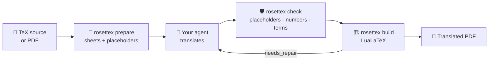

<!-- mcp-name: io.github.20235106-huynk/rosettex -->
<div align="center">

# rosettex 📜✨

**Translate scientific papers into 19+ languages — and keep the paper's own layout.**

[](pyproject.toml)
[](#-two-routes)
[](#-requirements)
[](#-connect-your-agent)
[](LICENSE)

[Quick Install](#-quick-install-let-your-agent-do-it) • [Features](#-key-features) • [How It Works](#-how-it-works) • [Usage](#-usage) • [Languages](#-languages) • [Manual Install](#-manual-install)


<sub>A born-digital PDF (left) and rosettex's Vietnamese output (right): same page, same figure, same fonts for names and
formulas. Paper: Berestov et al., CEUR-WS Vol-3550 (CC BY 4.0).</sub>

</div>

---

`rosettex` is a tool for **AI coding agents** ([Claude Code](https://claude.ai/code), [Gemini CLI](https://github.com/google-gemini/gemini-cli),
Antigravity, or any MCP client) that translates whole scientific papers.

**rosettex does not translate by itself — your agent is the translator.** rosettex does the engineering around it:
it splits the paper into question sheets with protected placeholders, checks every answer against strict rules, and
typesets the result so formulas, figures, citations and links stay real, selectable and clickable.

## 🌟 Key Features

| Feature | Description |
|---|---|
| 🤖 **Built for agents** | Every command speaks `--json` and returns the next command to run (`next_argv`); an agent can drive the whole loop and resume after any interruption. |
| 📐 **Original layout** | From TeX source the paper is rebuilt with its own class and packages; from a PDF the original pages are kept and only the text in the translated boxes is replaced. |
| 🧮 **Formulas stay formulas** | Inline and display math, citations and links become placeholders (`⟦m1⟧`, `⟦l2⟧`) the translation must keep; on PDFs they are copied as vector snippets of the original. |
| 🛡️ **Strict checks** | `rosettex check` catches lost placeholders, changed numbers, glossary violations, untranslated text and over-long answers before anything is built. |
| 🔁 **Repair loop** | When text does not fit, `build` answers `needs_repair` with the segments to shorten and by how much; nothing is silently cut. |
| 🌐 **Many scripts** | Latin, Cyrillic, CJK, Arabic/Persian/Urdu, Devanagari, Bengali, Tamil, Thai, Myanmar, Ethiopic … with bundled fonts (Noto, Vazirmatn) and copy/search-friendly output. |

## 🔀 Two Routes

| | From TeX source | From a born-digital PDF |
|---|---|---|
| **Input** | folder, archive, arXiv ID or link | a PDF with a text layer (journals, arXiv PDF-only, Word exports) |
| **Output** | the paper recompiled with LuaLaTeX in the target language | the original pages with translated text in the same boxes |
| **Best for** | any paper with source; changes of writing direction (e.g. English → Arabic) | papers without source |

## 🔄 How It Works



```bash
rosettex fetch 2108.07760 -o work         # folder, archive, arXiv ID/link, or a local .pdf
rosettex prepare work --lang vi           # question sheets in work/read/, glossary in work/terms.md
# … the agent appends "sNNNN <translation>" lines to work/out/NN.txt …
rosettex check work                       # repeat until ok
rosettex build work --out paper.vi.pdf    # may ask for shorter text (needs_repair), then build again
```

## 🚀 Quick Install: Let Your Agent Do It

> [!TIP]
> Copy the prompt below and send it to your coding agent. It installs everything into your home folder and asks before
> any download.

```text
Install the tool "rosettex" on this computer and connect it to yourself, so that later I can ask you to translate
scientific papers. Source: https://github.com/20235106-huynk/rosettex

Rules: never use sudo; install only into my home folder (~/.rosettex, the folder where uv puts tools, and the skill
folders written by "rosettex install-skill"); ask me before running a remote installer or editing my shell profile;
run one command at a time and show me any error.

1. uv: run "uv --version". If missing, ask me, then install it with the official installer
   (the commands are on https://docs.astral.sh/uv/getting-started/installation/).
2. rosettex: run "uv tool install git+https://github.com/20235106-huynk/rosettex", then "rosettex --help".
   If the command is not found, use the path from "uv tool dir --bin".
3. TeX: run "rosettex setup --json". If it asks (ask_user), ask me exactly that question; on yes run its next_argv and
   keep running next_argv while state is "partial". If I prefer my own TeX Live, run "rosettex setup --tex system --json".
4. Run "rosettex doctor --json" and tell me the result.
5. Run "rosettex install-skill --json" so you know when and how to use rosettex.
6. Report what you installed and give me an example request, such as:
   "Translate the paper ~/papers/attention.pdf into Vietnamese and save it in ~/translated/".
```

## 📖 Usage

Ask your agent in plain language:

```text
Translate arXiv 1512.03385 into Simplified Chinese and save it as ~/papers/resnet.zh.pdf
```

The agent fetches the paper, picks the field and key terms, translates sheet by sheet, runs `check` until it passes,
builds the PDF, shortens any text `build` reports as too long, and tells you where the PDF is and what to look at.

## 🔌 Connect Your Agent

This repository is a plugin at its root: one skill (`skills/rosettex`) and one MCP server (`uvx` runs `rosettex-mcp` from
the tagged release), so you need [uv](https://docs.astral.sh/uv/) on PATH. Install it into your harness with its own command:

| Harness | Command |
|---|---|
| **Claude Code** | `/plugin marketplace add 20235106-huynk/rosettex`, then `/plugin install rosettex@rosettex` |
| **Codex CLI** | `codex plugin marketplace add 20235106-huynk/rosettex --ref v1.0.0`, then install `rosettex` from the Plugins tab |
| **GitHub Copilot CLI** | `copilot plugin install 20235106-huynk/rosettex` |
| **VS Code (Copilot)** | "Chat: Install Plugin from Source", then the repository URL |
| **Antigravity** | `agy plugin install https://github.com/20235106-huynk/rosettex` |
| **Gemini CLI** | `gemini extensions install https://github.com/20235106-huynk/rosettex --ref v1.0.0` |
| **Hermes** | `hermes plugins install 20235106-huynk/rosettex/plugins/hermes`, then `hermes plugins enable rosettex` (the slim package: Hermes rejects the full repository) |
| **Factory Droid, Auggie, Junie, Qwen Code, Devin, Kiro, goose** | their plugin or extension command on the repository URL (they read the Claude Code or Agent Plugins files) |
| **Any harness with Agent Skills** | `rosettex install-skill` (writes `~/.agents/skills`, `~/.claude/skills`, `~/.gemini/config/skills`, and `~/.cline`, `~/.kiro`, `~/.qoder`, `~/.trae`, `~/.codebuddy` skills when those folders exist) |
| **Any MCP client** | a stdio server: `uvx --from git+https://github.com/20235106-huynk/rosettex@v1.0.0 rosettex-mcp` (or `rosettex-mcp` after `uv tool install`) |
| **Anything else** | tell the agent: *"Run `rosettex guide` and follow it."* |

Claude Code, in one step: `/plugin install rosettex --marketplace 20235106-huynk/rosettex`. Harnesses that accept only
remote MCP servers (Android Studio, Replit, ChatGPT custom MCP) cannot run the stdio server; use the skill and the CLI.
The manifests are generated from the package version: `uv run python -m rosettex.skill` (`--check` in CI).

To try the server from a checkout, `plugins/mcp.dev.json` runs it with `uv run --project .`.

## 🛠️ Manual Install

<details>
<summary><b>Commands, requirements and environment variables</b></summary>

### Requirements
- Python ≥ 3.11 and [uv](https://docs.astral.sh/uv/).
- LuaLaTeX: `rosettex setup` installs a private TinyTeX into `~/.rosettex` (asks first), or
  `rosettex setup --tex system` uses an existing TeX Live.

```bash
uv tool install git+https://github.com/20235106-huynk/rosettex
rosettex setup              # or: rosettex setup --tex system
rosettex doctor
rosettex install-skill
```

### Environment variables
- `ROSETTEX_HOME`: where rosettex keeps its TeX toolchain and state (default `~/.rosettex`).

### Update and uninstall
```bash
uv tool upgrade rosettex && rosettex install-skill --force
rosettex install-skill --remove && uv tool uninstall rosettex   # then delete the folder ~/.rosettex
```
</details>

## 🌍 Languages

Language data covers about 50 target languages (`src/rosettex/data/langs/`). Tested end to end:

| Script | Languages |
|---|---|
| **Latin** | Vietnamese, French |
| **Cyrillic** | Russian |
| **Han / Kana / Hangul** | Chinese (Simplified, Traditional), Japanese, Korean |
| **Arabic** (RTL) | Arabic, Persian, Urdu |
| **Indic** | Hindi, Bengali, Gujarati, Kannada, Tamil, Telugu |
| **Southeast Asian** | Thai, Myanmar |
| **Ethiopic** | Amharic |

## ⚠️ Limits

- The PDF route needs a born-digital PDF with a text layer (no OCR) and keeps the writing direction: a left-to-right
  paper cannot become right-to-left there — use the TeX source for that.
- Table contents are not translated; scanned PDFs, vertical writing and PDF forms are not supported.
- Very tight layouts may need shorter translations (`needs_repair`) or a slightly smaller font.

## 📄 License

MIT — see [`LICENSE`](LICENSE). Bundled fonts are under the SIL Open Font License 1.1
(`src/rosettex/data/fonts/LICENSES/`).
