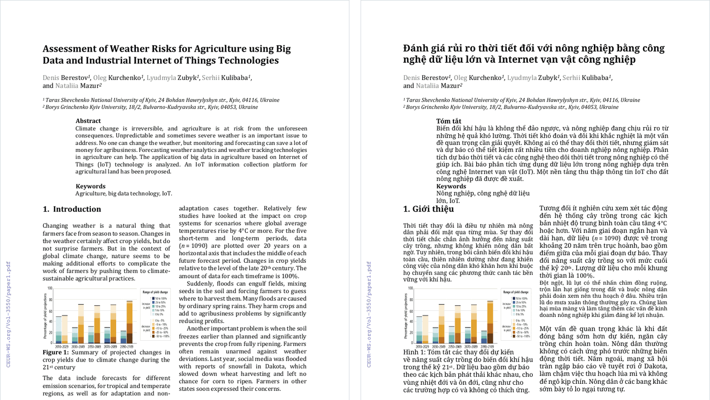
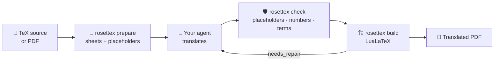

<!-- mcp-name: io.github.20235106-huynk/rosettex -->
<div align="center">

# rosettex 📜✨

**Translate scientific papers into 19+ languages — and keep the paper's own layout.**

[](https://pypi.org/project/rosettex/)
[](https://github.com/20235106-huynk/rosettex/actions/workflows/ci.yml)
[](https://pypi.org/project/rosettex/)
[](#-connect-your-agent)
[](https://github.com/20235106-huynk/rosettex/blob/main/LICENSE)

[Quick Install](#-quick-install-let-your-agent-do-it) • [Features](#-key-features) • [How It Works](#-how-it-works) • [Connect Your Agent](#-connect-your-agent) • [Languages](#-languages) • [Manual Install](#-manual-install)



<sub>A born-digital PDF (left) and rosettex's Vietnamese output (right): same page, same figure, same fonts for names and
formulas. Paper: Berestov et al., CEUR-WS Vol-3550 (CC BY 4.0).</sub>

</div>

---

`rosettex` lets an **AI coding agent** translate a whole scientific paper — from its **TeX source** or from a
**born-digital PDF** — and returns a PDF with the paper's own layout.

**rosettex does not translate by itself — your agent is the translator.** rosettex does the engineering around it: it
splits the paper into question sheets with protected placeholders, checks every answer against strict rules, and
typesets the result so formulas, figures, citations and links stay real, selectable and clickable. It ships as a CLI, an
MCP server and an Agent Skill, packaged as a plugin for the major agent harnesses.

## 🌟 Key Features

| Feature | Description |
|---|---|
| 🤖 **Built for agents** | Every command speaks `--json` and returns the next command to run (`next_argv`); an agent can drive the whole loop and resume after any interruption. |
| 📐 **Original layout** | From TeX source the paper is rebuilt with its own class and packages; from a PDF the original pages are kept and only the text in the translated boxes is replaced. |
| 🧮 **Formulas stay formulas** | Math, citations and links become placeholders (`⟦m1⟧`, `⟦l2⟧`) the translation must keep; on PDFs they are copied as vector snippets of the original. A formula the agent copies verbatim is protected automatically. |
| 🛡️ **Strict checks** | `rosettex check` catches lost placeholders, changed numbers, glossary violations, untranslated text and over-long answers before anything is built. |
| 🔁 **Repair loop** | When text does not fit, `build` answers `needs_repair` with the segments to shorten and by how much; nothing is silently cut. |
| 🌐 **Many scripts** | Latin, Cyrillic, CJK, Arabic/Persian/Urdu, Devanagari, Bengali, Tamil, Thai, Myanmar, Ethiopic … with bundled fonts (Noto, Vazirmatn) and copy/search-friendly output. |
| 🔌 **One plugin, many harnesses** | Claude Code, Codex, GitHub Copilot, VS Code, Cursor, Antigravity, Gemini CLI, Hermes, Devin and more install it from this repository; any MCP client or Agent Skills host can use it too. |
| 💻 **Linux, macOS, Windows** | CI runs the full smoke test on all three. |

## 🔀 Two Routes

| | From TeX source | From a born-digital PDF |
|---|---|---|
| **Input** | folder, archive, arXiv ID or link | a PDF with a text layer (journals, arXiv PDF-only, Word exports) |
| **Output** | the paper recompiled with LuaLaTeX in the target language | the original pages with translated text in the same boxes |
| **Best for** | any paper with source; changes of writing direction (e.g. English → Arabic) | papers without source |

## 🔄 How It Works



```bash
rosettex fetch 2108.07760 -o work         # folder, archive, arXiv ID/link, or a local .pdf
rosettex prepare work --lang vi           # question sheets in work/read/, glossary in work/terms.md
# … the agent appends "sNNNN <translation>" lines to work/out/NN.txt …
rosettex check work                       # repeat until ok
rosettex build work --out paper.vi.pdf    # may ask for shorter text (needs_repair), then build again
```

## 🚀 Quick Install: Let Your Agent Do It

> [!TIP]
> Copy the prompt below and send it to your coding agent. It installs everything into your home folder and asks before
> any download.

```text
Install the tool "rosettex" (https://pypi.org/project/rosettex/) on this computer and connect it to yourself, so that
later I can ask you to translate scientific papers.

Rules: never use sudo; install only into my home folder (~/.rosettex, the folder where uv puts tools, and the skill
folders written by "rosettex install-skill"); ask me before running a remote installer or editing my shell profile;
run one command at a time and show me any error.

1. uv: run "uv --version". If missing, ask me, then install it with the official installer
   (the commands are on https://docs.astral.sh/uv/getting-started/installation/).
2. rosettex: run "uv tool install rosettex", then "rosettex --help".
   If the command is not found, use the path from "uv tool dir --bin".
3. TeX: run "rosettex setup --json". If it asks (ask_user), ask me exactly that question; on yes run its next_argv and
   keep running next_argv while state is "partial". If I prefer my own TeX Live, run "rosettex setup --tex system --json".
4. Run "rosettex doctor --json" and tell me the result.
5. Connect yourself: if your harness can install plugins, install the rosettex plugin from
   https://github.com/20235106-huynk/rosettex (see its README table); otherwise run "rosettex install-skill --json".
6. Report what you installed and give me an example request, such as:
   "Translate the paper ~/papers/attention.pdf into Vietnamese and save it in ~/translated/".
```

Then just ask, for example: *"Translate arXiv 1512.03385 into Simplified Chinese and save it as ~/papers/resnet.zh.pdf."*
The agent fetches the paper, picks the field and key terms, translates sheet by sheet, runs `check` until it passes,
builds the PDF, shortens any text `build` reports as too long, and tells you where the PDF is.

## 🔌 Connect Your Agent

This repository is a plugin at its root: one skill (`skills/rosettex`) and one MCP server that `uvx` starts from the
tagged release, so [uv](https://docs.astral.sh/uv/) must be on PATH. The first run of `setup` installs TeX (the agent
asks you first).

### Install as a plugin

| Harness | Command |
|---|---|
| **Claude Code** | `/plugin marketplace add 20235106-huynk/rosettex`, then `/plugin install rosettex@rosettex` |
| **Claude Desktop / claude.ai** | Customize › Plugins › Add marketplace `20235106-huynk/rosettex` |
| **Codex CLI / ChatGPT desktop** | `codex plugin marketplace add 20235106-huynk/rosettex`, then install `rosettex` from the Plugins tab |
| **GitHub Copilot CLI** | `copilot plugin install 20235106-huynk/rosettex` |
| **VS Code (Copilot)** | *Chat: Install Plugin from Source* with the repository URL, or add `20235106-huynk/rosettex` to `chat.plugins.marketplaces` |
| **Antigravity** | `agy plugin install https://github.com/20235106-huynk/rosettex` |
| **Gemini CLI** | `gemini extensions install https://github.com/20235106-huynk/rosettex` |
| **Hermes** | `hermes plugins install 20235106-huynk/rosettex/plugins/hermes`, then `hermes plugins enable rosettex` |
| **Devin** (Desktop, CLI, cloud) | `devin plugins install 20235106-huynk/rosettex`; cloud: Customize › Add plugin › From repository |
| **Factory Droid** | `droid plugin marketplace add 20235106-huynk/rosettex`, then `droid plugin install rosettex@rosettex` |
| **Auggie** | `auggie plugin marketplace add 20235106-huynk/rosettex` |
| **Junie CLI** | `/extensions marketplace add 20235106-huynk/rosettex`, then `/extensions install rosettex` |
| **Qwen Code** | `qwen extensions install 20235106-huynk/rosettex` |
| **goose** | `goose plugin install https://github.com/20235106-huynk/rosettex.git` |
| **Kiro IDE** | Powers › Add Custom Power › Import power from a repository URL |

### Skill + MCP server (every other harness)

1. Install the skill: `rosettex install-skill` (writes `~/.agents/skills`, `~/.claude/skills`, `~/.gemini/config/skills`,
   and the Cline, Kiro, Qoder, Trae and CodeBuddy skill folders when they exist), or `npx skills add 20235106-huynk/rosettex`.
2. Add the MCP server. Most harnesses (Cursor, Cline, Kiro CLI, Qoder, Kimi Code, Pi, CodeBuddy, Warp, Junie, Roo/Zoo,
   Tabnine, Trae, JetBrains AI Assistant) take the standard block:

```json
{ "mcpServers": { "rosettex": { "command": "uvx", "args": ["--from", "rosettex", "rosettex-mcp"] } } }
```

<details>
<summary><b>Harnesses with their own MCP syntax</b></summary>

| Harness | Where | Entry |
|---|---|---|
| OpenCode | `opencode.json` | `"mcp": { "rosettex": { "type": "local", "command": ["uvx", "--from", "rosettex", "rosettex-mcp"] } }` |
| Kilo | `kilo.jsonc` | same as OpenCode |
| Crush | `crush.json` | `"mcp": { "rosettex": { "type": "stdio", "command": "uvx", "args": ["--from", "rosettex", "rosettex-mcp"] } }` |
| goose | `config.yaml` | `extensions: { rosettex: { type: stdio, cmd: uvx, args: [--from, rosettex, rosettex-mcp] } }` |
| Mistral Vibe | `config.toml` | `[[mcp_servers]]` with `name = "rosettex"`, `transport = "stdio"`, `command = "uvx"`, `args = [...]` |
| Amp | CLI | `amp mcp add rosettex -- uvx --from rosettex rosettex-mcp` |
| Zed | `settings.json` | `"context_servers": { "rosettex": { "command": "uvx", "args": [...] } }` |
| Zencoder | VS Code `settings.json` | `"zencoder.mcpServers"` with the standard block |
| Visual Studio | `%USERPROFILE%\.mcp.json` | `"servers": { "rosettex": { "command": "uvx", "args": [...] } }` |
| GitHub Copilot cloud agent | repository Settings › Copilot › MCP servers | `"type": "local"`, `"tools": ["*"]`, and install uv in `copilot-setup-steps.yml` |

Harnesses that accept only remote MCP servers (Android Studio, Replit, ChatGPT custom MCP) cannot run this stdio server;
use the skill and the CLI there. Without any integration, tell the agent: *"Run `rosettex guide` and follow it."*
</details>

## 🛠️ Manual Install

<details>
<summary><b>Commands, requirements and environment variables</b></summary>

### Requirements
- Python ≥ 3.11 and [uv](https://docs.astral.sh/uv/).
- LuaLaTeX: `rosettex setup` installs a private TinyTeX into `~/.rosettex` (asks first; retries flaky CTAN mirrors), or
  `rosettex setup --tex system` uses an existing TeX Live.

```bash
uv tool install rosettex
rosettex setup              # or: rosettex setup --tex system
rosettex doctor
rosettex install-skill
```

### Environment variables
- `ROSETTEX_HOME`: where rosettex keeps its TeX toolchain and state (default `~/.rosettex`).

### Update and uninstall
```bash
uv tool upgrade rosettex && rosettex install-skill --force
rosettex install-skill --remove && uv tool uninstall rosettex   # then delete the folder ~/.rosettex
```
</details>

## 🌍 Languages

Language data covers about 50 target languages (`src/rosettex/data/langs/`). Tested end to end:

| Script | Languages |
|---|---|
| **Latin** | Vietnamese, French |
| **Cyrillic** | Russian |
| **Han / Kana / Hangul** | Chinese (Simplified, Traditional), Japanese, Korean |
| **Arabic** (RTL) | Arabic, Persian, Urdu |
| **Indic** | Hindi, Bengali, Gujarati, Kannada, Tamil, Telugu |
| **Southeast Asian** | Thai, Myanmar |
| **Ethiopic** | Amharic |

## ⚠️ Limits

- The PDF route needs a born-digital PDF with a text layer (no OCR) and keeps the writing direction: a left-to-right
  paper cannot become right-to-left there — use the TeX source for that.
- Table contents are not translated; scanned PDFs, vertical writing and PDF forms are not supported.
- Very tight layouts may need shorter translations (`needs_repair`) or a slightly smaller font.

## 📄 License

MIT — see [`LICENSE`](https://github.com/20235106-huynk/rosettex/blob/main/LICENSE). Bundled fonts are under the SIL Open
Font License 1.1 (`src/rosettex/data/fonts/LICENSES/`). Release notes: [`CHANGELOG.md`](https://github.com/20235106-huynk/rosettex/blob/main/CHANGELOG.md).
